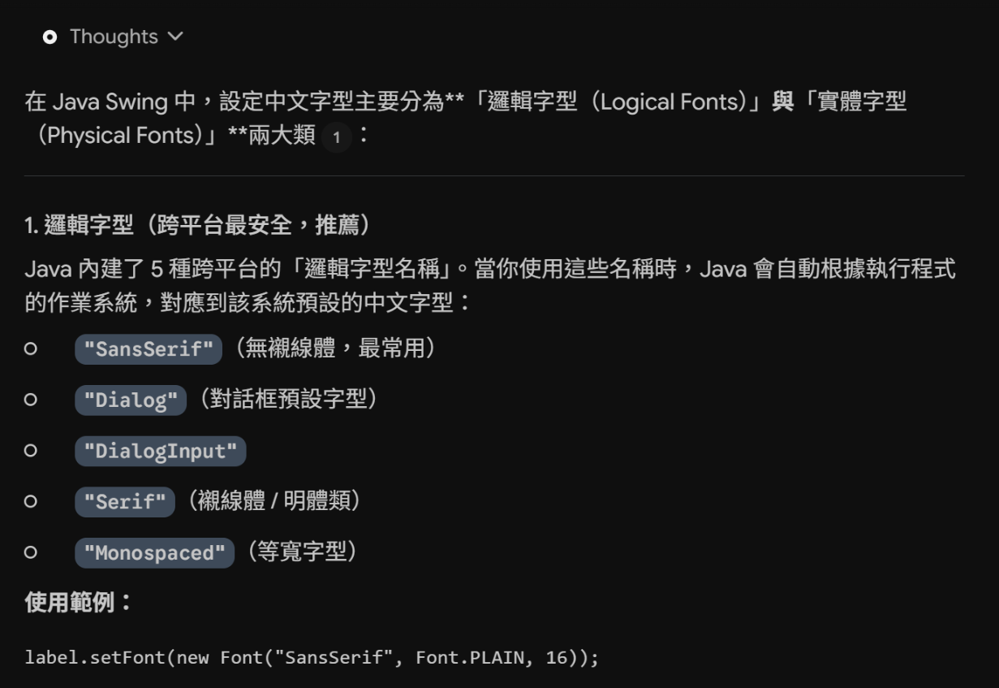
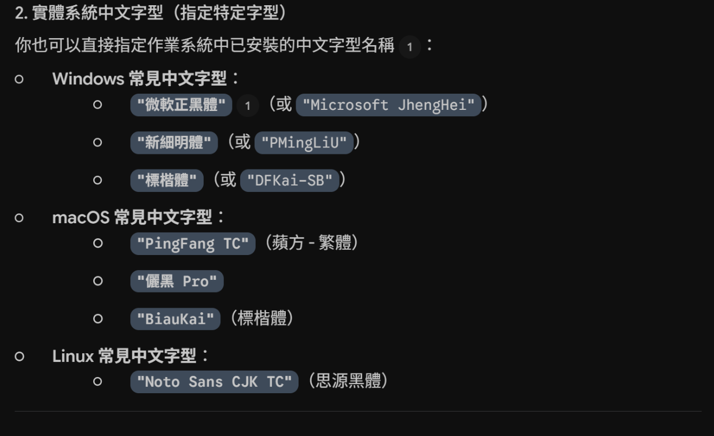
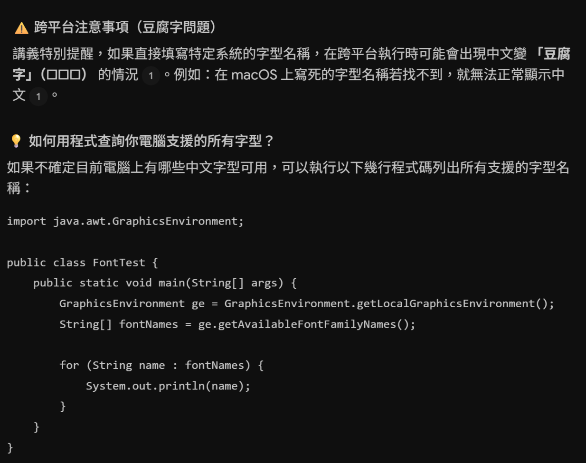
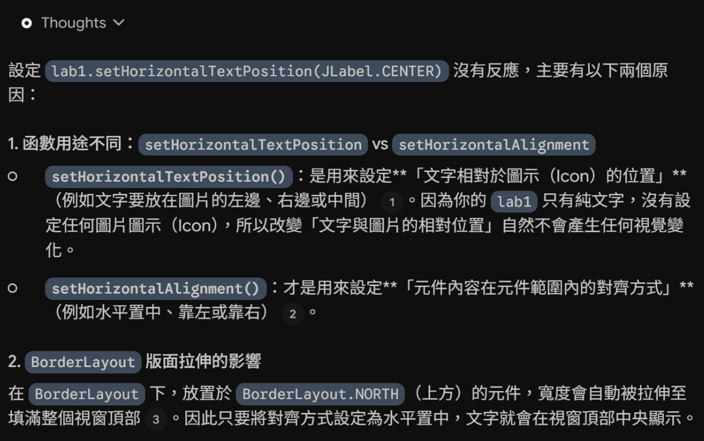
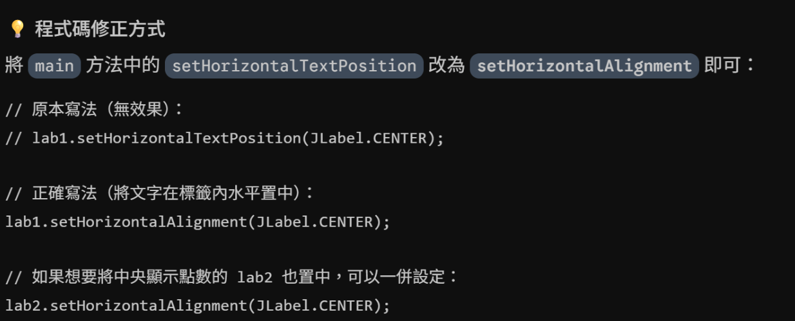

## AI對話截圖
### Q1：在java中有哪些支援的中文字型?

### Q2：我的程式碼(Exercise1)中使用的lab1.setHorizontalTextPosition(JLabel.CENTER);為何沒有反應?

## Reflection
在進行 Exercise1 的時候我遇到兩個難題：
1. 我不知道 Java 支援哪些內建字型
    > 詢問 AI 後，他快速列舉了常見作業系統在 Java 中對應的字型名稱，並教我怎麼自己查詢現系統支援的字型列表，幫我省下許多查找資料和逐一測試字型名稱的時間。
2. 我使用 "setHorizontalTextPosition(JLabel.CENTER)" 卻發現畫面沒有產生預期的置中效果
    > AI 告訴我 "setHorizontalTextPosition" 是控制文字相對於 Icon 的水平位置，而非 JLabel 在容器中的置中；文字在未設置 Icon 時的對齊方式，應使用 "setHorizontalAlignment"。

整體而言，AI 能幫我釐清一些觀念，並快速的幫我把錯誤的用法揪出來，比上網找答案和自己慢慢思考快了不少。但還是很害怕如果我跳過了自己思考的過程，會變得太依賴 AI。