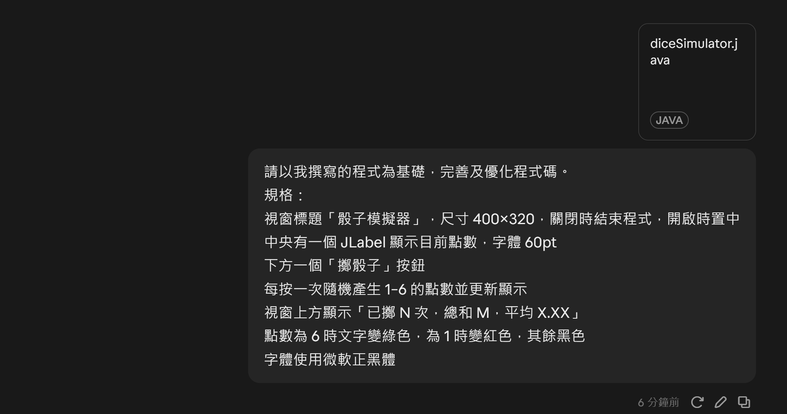
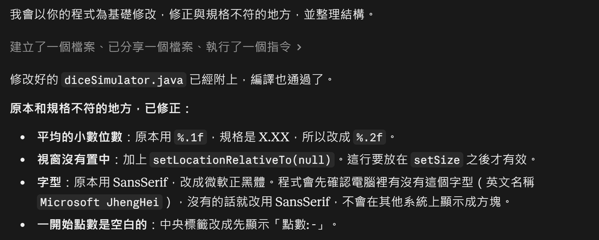
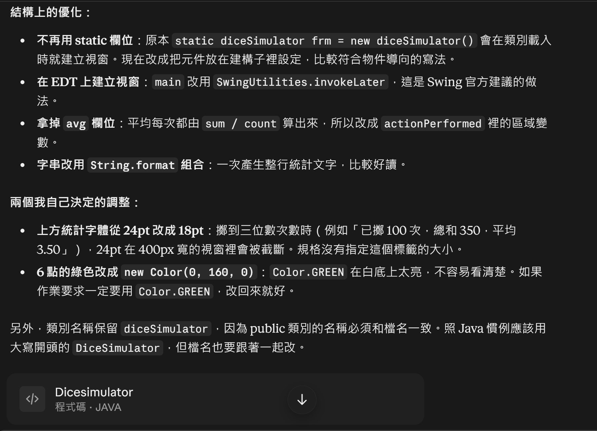
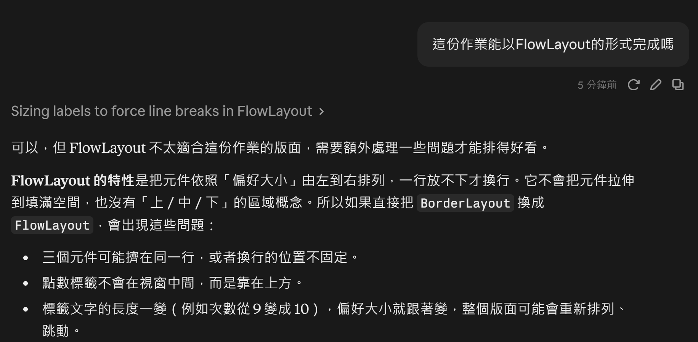
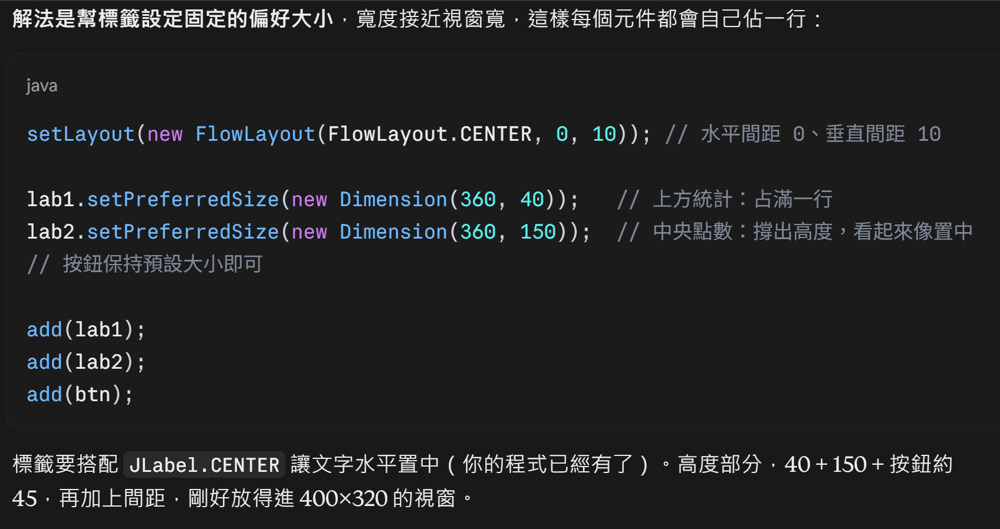
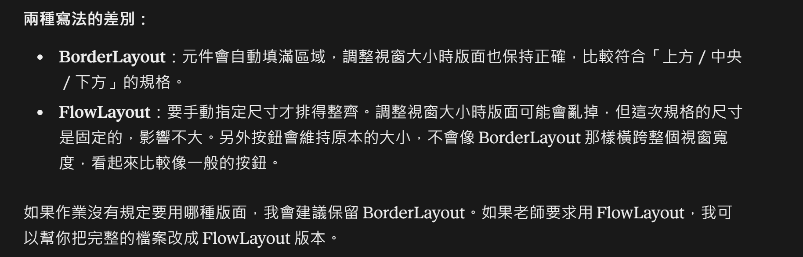

## AI對話紀錄
### Q1：

### Q2：

## Reflection
請 AI 幫我完善了之前的作業 1，也好奇如果用 FlowLayout 寫得出來嗎？
1. AI 修正的地方
    - 平均值原本用 `%.1f`，不符合規格的 X.XX，改成 `%.2f`
    - 加上 `setLocationRelativeTo(null)`，讓視窗開啟時置中（要放在 `setSize` 之後才有效）
    - 字型改成微軟正黑體，並在電腦沒有安裝時改用 SansSerif
    - 拿掉 static 的視窗物件，改在建構子裡設定元件，`main` 改用 `SwingUtilities.invokeLater` 在 EDT 上建立視窗
    - 上方統計字體縮小，避免擲到三位數次數時文字被截斷

2. 關於 FlowLayout
    - 可以做到，但 FlowLayout 是依照元件的偏好大小由左到右排列，不會拉伸元件，也沒有上、中、下的區域概念
    - 必須用 `setPreferredSize` 幫標籤設定固定寬高，每個元件才會各佔一行，點數也才會看起來在中間（這邊太複雜讓我放棄了）    
    - 這份作業「上方統計、中央點數、下方按鈕」的版面，比較適合用 BorderLayout；FlowLayout 則要手動調整尺寸

整體來說規格變正常，像小數位數、視窗置中這種細節 AI 都幫我補好了。而且幸好一開始就選對 Layout，可以少寫很多手動調整尺寸的程式碼。