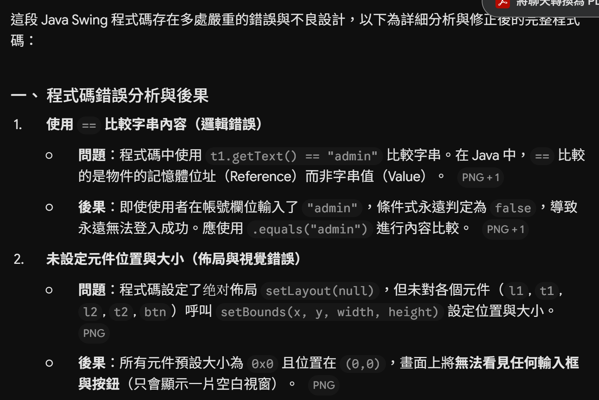
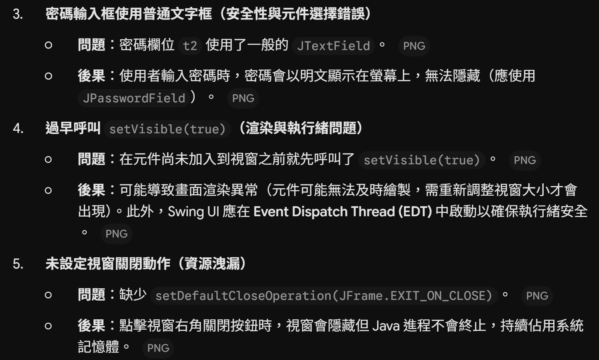

## 對話紀錄
### Q：這是一段 Java Swing 程式碼，分析這段程式碼哪出錯及其後果為何，並輸出正確可執行的完整程式碼。




### AI 修復後的程式碼
```
import javax.swing.*;
import java.awt.*;

public class GoodLogin extends JFrame {
    private JTextField t1;
    private JPasswordField t2;

    public GoodLogin() {
        // 1. 設定視窗基本屬性
        setTitle("登入");
        setSize(320, 180);
        setDefaultCloseOperation(JFrame.EXIT_ON_CLOSE); // 設定關閉視窗時結束程式
        setLocationRelativeTo(null); // 視窗置中顯示

        // 2. 使用 LayoutManager 進行元件排版
        JPanel panel = new JPanel(new GridLayout(3, 2, 10, 10));
        panel.setBorder(BorderFactory.createEmptyBorder(15, 15, 15, 15)); // 設定外邊距

        JLabel l1 = new JLabel("帳號:");
        t1 = new JTextField();
        JLabel l2 = new JLabel("密碼:");
        t2 = new JPasswordField(); // 使用密碼輸入框以掩碼顯示
        JButton btn = new JButton("登入");

        // 3. 將元件加入面板
        panel.add(l1);
        panel.add(t1);
        panel.add(l2);
        panel.add(t2);
        panel.add(new JLabel()); // 佔位空元件以對齊按鈕
        panel.add(btn);

        add(panel);

        // 4. 設定按鈕事件監聽器
        btn.addActionListener(e -> {
            String username = t1.getText();
            String password = new String(t2.getPassword());

            // 正確使用 .equals() 比較字串內容
            if ("admin".equals(username) && "123456".equals(password)) {
                JOptionPane.showMessageDialog(this, "登入成功！", "訊息", JOptionPane.INFORMATION_MESSAGE);
            } else {
                JOptionPane.showMessageDialog(this, "帳號或密碼錯誤！", "錯誤", JOptionPane.ERROR_MESSAGE);
            }
        });

        // 5. 元件加載完畢後最後顯示視窗
        setVisible(true);
    }

    public static void main(String[] args) {
        // 在 Event Dispatch Thread (EDT) 中啟動 Swing GUI 確保執行緒安全
        SwingUtilities.invokeLater(() -> new GoodLogin());
    }
}
```

## Reflection
AI 提到，在 Java 中"==" 比較的是兩個物件的記憶體 Reference 而非字串實際內容。這導致即便使用者在畫面上輸入了正確的 "admin"，條件式永遠判定為 false，使得登入功能完全失效。這恰恰是我以前曾犯過的錯誤，而且是 AI 給出的答案。本此實作提醒我們紮實基本功和批判性思考能力的重要性，畢竟我們還得用 AI debug AI... 