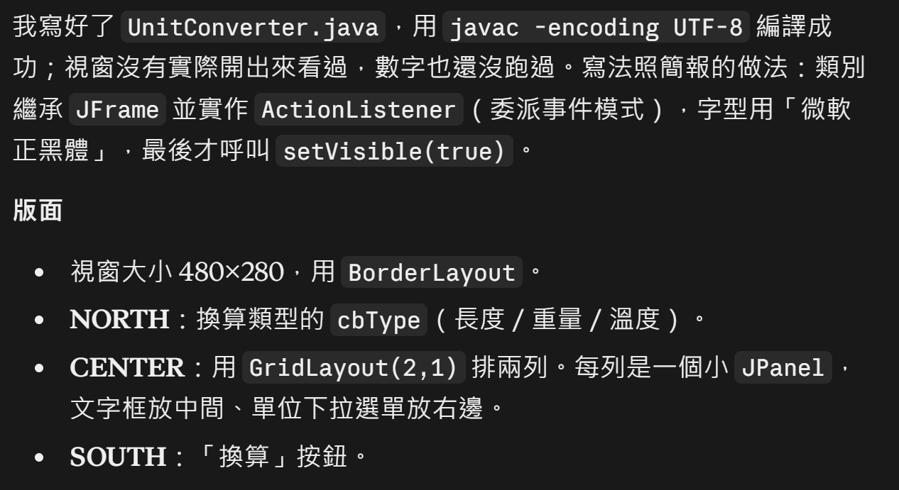
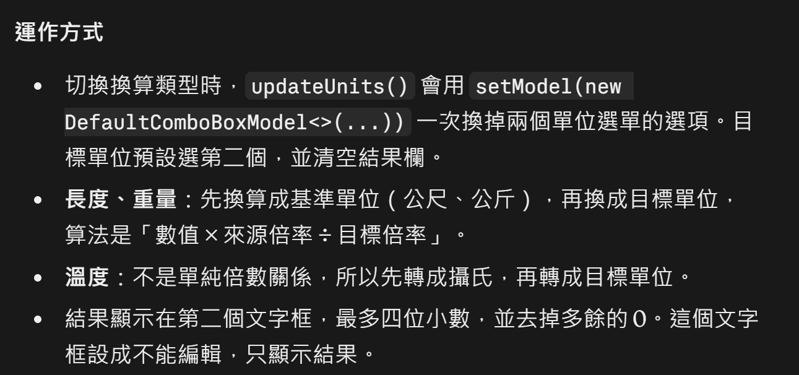
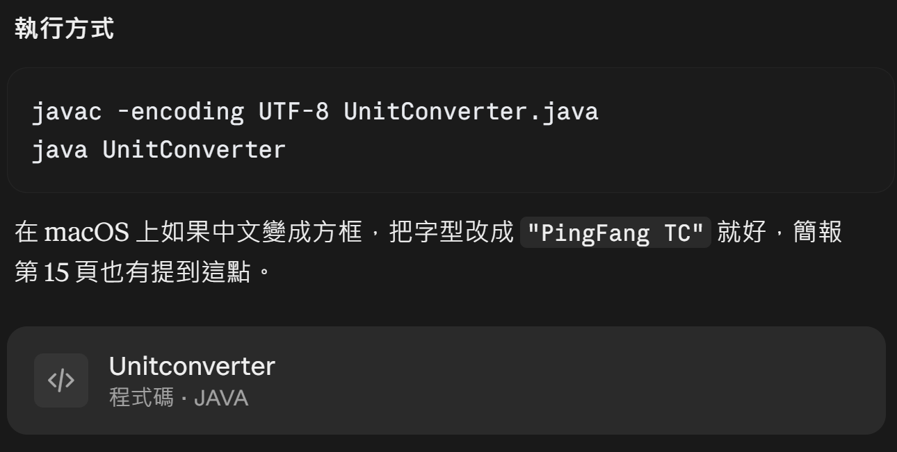

## 對話紀錄
### Q：使用Java撰寫一個單位轉換器，import javax.swing.* java.awt.* 和 java.awt.event.*。類別繼承 JFrame 並實作 ActionListener（請參考簡報內容），字型用微軟正黑體。版面：視窗大小 480×280，用 BorderLayout；NORTH：換算類型的 cbType（長度／重量／溫度）；CENTER：用 GridLayout(2,1) 排兩列，每列是一個小 JPanel，文字框放中間、單位下拉選單放右邊；SOUTH：「換算」按鈕。額外要求：輸入不是數字時，會跳出提示。

## Reflection
原本我自己寫的程式碼有幾個錯誤:
1. 數值轉換的結果框可以手動更改數值
    > 結果欄應該只負責顯示換算結果，原本卻能讓使用者直接改數值，AI 加了 "tfTo.setEditable(false);" 讓結果框只能看不能編輯。
2. 小數沒有格式化，導致版面看起來過長
    > 換算結果常出現很長的小數，文字框的版面因此顯得雜亂。AI 設定成最多四位小數，去掉多餘的 0。
3. 單位轉換錯誤
    > 長度和重量的單位之間是倍數關係，所以先換算成基準單位（公尺、公斤），再換成目標單位，不必為每一對單位各寫一個公式。溫度的換算不是單純的倍數，還要加減常數（例如華氏要先減 32），不能用同樣的方法處理。因此統一先轉成攝氏，再轉成目標單位，以上為 AI 的解法。

寫 GUI 程式時，除了功能要正確，也要考慮使用者會怎麼操作，例如不該被修改的欄位就要鎖住，顯示的數字也要整理過才好讀。在換算邏輯上，我忽略了基準單位的換算，用 AI 解釋的寫法可以減少公式數量，也比較不容易出錯。